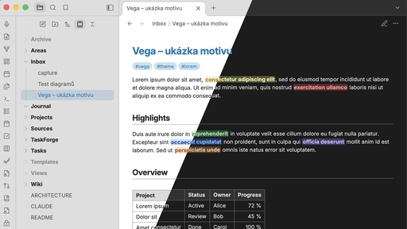

# Vega

A light touch on top of Obsidian's default theme. Vega keeps the familiar default look and refines a few details:

- **Toned app frame** – sidebars, tab bar and ribbon are slightly darker than the note in light mode and slightly lighter in dark mode, with matching dividers, so the note stands out.
- **File explorer** – folders in bold, the active note highlighted in the accent color.
- **Note** – the note title in the accent color and slightly larger, tags with a stronger accent background, a thin rule under H1 and H2.
- **Tables** – visible borders, a bold gray header row and, in Bases, bold totals and borders in the totals row.
- **Fonts** – Inter, falling back to Verdana.

Works in light and dark mode.

## Settings

With the [Style Settings](https://github.com/obsidian-community/obsidian-style-settings) plugin you can:

- change the text and interface fonts,
- adjust how much darker (light mode) or lighter (dark mode) the frame is,
- turn off any of the features above individually.

Without Style Settings every feature is on.

Font size is an Obsidian setting (**Settings → Appearance → Font size**), not part of the theme. A font chosen in **Settings → Appearance** takes precedence over the theme's fonts.

## Installation

### From the theme gallery

Not published yet.

### Manually

1. Download `manifest.json` and `theme.css` from the [latest release](../../releases/latest).
2. Copy them to `<your vault>/.obsidian/themes/Vega/`.
3. Select **Vega** in **Settings → Appearance → Themes**.

## License

[MIT](LICENSE)
