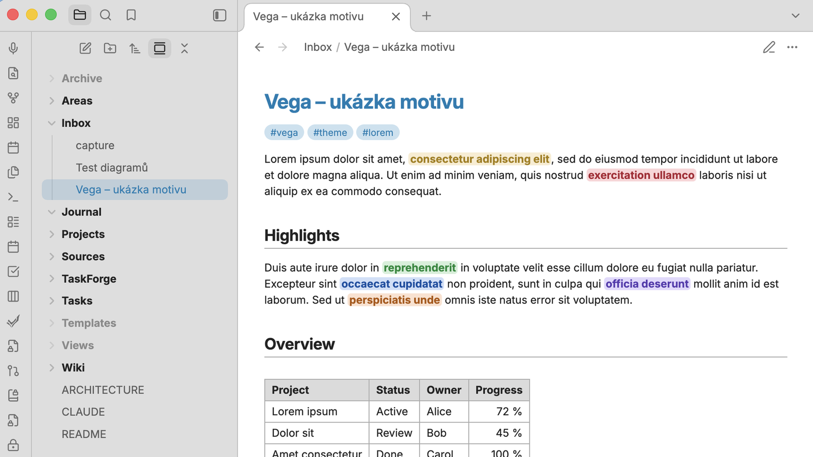
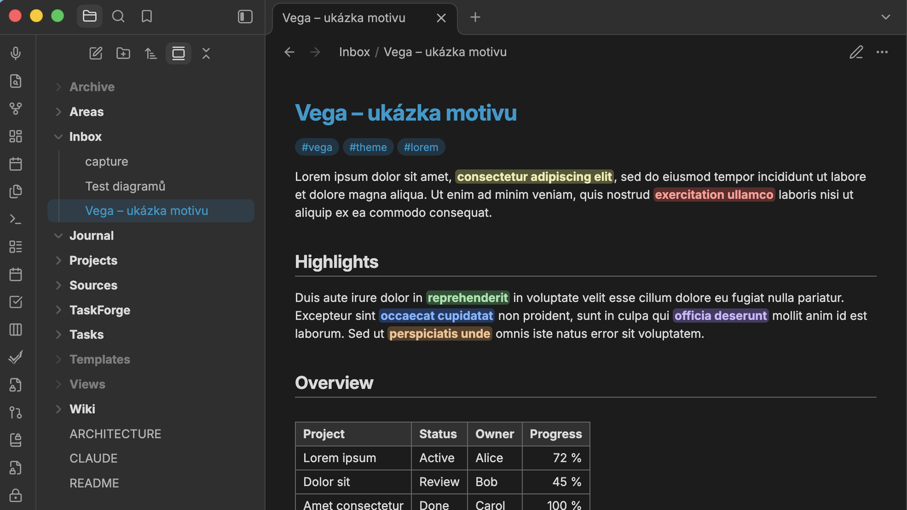

# Vega

A light touch on top of Obsidian's default theme. Vega keeps the familiar default look and refines a few details:

- **Toned app frame** – sidebars, tab bar and ribbon are slightly darker than the note in light mode and slightly lighter in dark mode, with matching dividers, so the note stands out.
- **File explorer** – folders in bold, the active note highlighted in the accent color, and optionally file icons by file type and dimmed folders (Archive, Attachments, Backup, Templates, Temporary, Views) – both off by default.
- **Note** – the note title in the accent color and slightly larger, tags with a stronger accent background, a thin rule under H1 and H2.
- **Highlights** – `==highlighted text==` in the style of Apple Notes: a light tinted background with bold text in a darker shade of the same color (lighter in dark mode). Works for the default highlight and for colored highlights.
- **Tables** – visible borders, a bold gray header row and, in Bases, bold totals and borders in the totals row.
- **Fonts** – Inter, falling back to Verdana.

Works in light and dark mode.

| Light | Dark |
| --- | --- |
|  |  |

## Settings

With the [Style Settings](https://github.com/obsidian-community/obsidian-style-settings) plugin you can:

- change the text and interface fonts,
- adjust how much darker (light mode) or lighter (dark mode) the frame is,
- adjust how dark (light mode) or light (dark mode) the highlighted text is,
- turn off any of the features above individually,
- turn on file icons in the file explorer (accent-colored or muted),
- dim selected folders and set how faded they are.

Without Style Settings every feature is on, except file icons and dimmed folders, which are off.

Font size is an Obsidian setting (**Settings → Appearance → Font size**), not part of the theme. A font chosen in **Settings → Appearance** takes precedence over the theme's fonts.

## Installation

### From the theme gallery

1. Open **Settings → Appearance → Themes → Manage**.
2. Search for **Vega**, then select **Install and use**.

### Manually

1. Download `manifest.json` and `theme.css` from the [latest release](../../releases/latest).
2. Copy them to `<your vault>/.obsidian/themes/Vega/`.
3. Select **Vega** in **Settings → Appearance → Themes**.

## Credits

File icons are from [Lucide](https://lucide.dev) (ISC license).

## License

[MIT](LICENSE)
